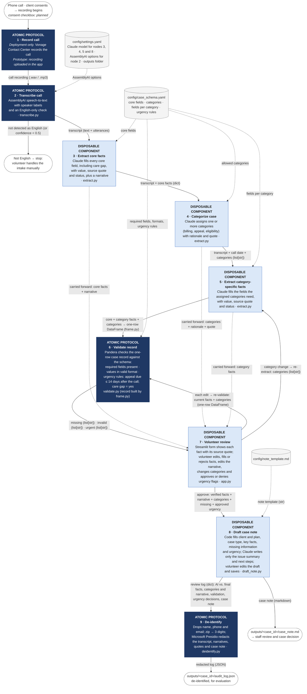

# Health Advocacy Intake

[](https://github.com/ferragamoashley-code/health-advocacy-intake/actions/workflows/tests.yml)

Black-box unit tests for the atomic protocols in an AI-assisted intake workflow for health advocacy nonprofits.

See the [wire diagram](#wire-diagram) for the full workflow.

## Wire diagram

The full intake workflow, from the incoming call to the reviewed case note and the de-identified audit log. Numbers match the node numbers in the code (`intake/` and `app.py`).

- **Atomic protocol** (dark): an externally maintained tool, covered by the black-box unit tests in `tests/` (Record call is not tested; see `tests/vonage/README.md`).
- **Disposable component** (light): code written for this workflow that can be regenerated.
- **Cylinders**: organization-specific config. Editing `config/` adapts the workflow to another organization.
- **Dotted arrows**: config inputs (from a cylinder), or data the app keeps in memory and carries forward to review.



## Protocols

| Protocol | Status | Details |
|---|---|---|
| AssemblyAI (transcription) | Complete (46 passed, 5 skipped) | [tests/assemblyai](tests/assemblyai/README.md) |
| Pandera (schema validation) | Complete (26 passed) | [tests/pandera](tests/pandera/README.md) |
   | Presidio (de-identification) | Complete (32 passed) | [tests/presidio](tests/presidio/README.md) |
| Vonage (call recording) | Not tested (no license) | [tests/vonage](tests/vonage/README.md) |

## Prototype

`app.py` is a working Streamlit prototype of the full intake workflow. A recorded call goes in; a reviewed case note and a de-identified audit log come out.

| Node | Step | File |
|---|---|---|
| 1 | Record call (Vonage) | not included, no license; upload a recording instead |
| 2 | Transcribe (AssemblyAI) | `intake/transcribe.py` |
| 3 | Extract core facts and narrative (Claude) | `intake/extract.py` |
| 4 | Categorize case (Claude) | `intake/extract.py` |
| 5 | Extract category-specific facts (Claude) | `intake/extract.py` |
| — | Build case data frame | `intake/frame.py` |
| 6 | Validate against case schema (Pandera) | `intake/validate.py` |
| 7 | Volunteer review | `app.py` |
| 8 | Draft case note (Claude + template) | `intake/draft_note.py` |
| 9 | De-identify audit log (Presidio) | `intake/deidentify.py` |

Claude extracts every fact with the quote it came from, and the volunteer reviews everything before use: they can edit, fill in or reject facts, change the case category (which re-runs node 5), and approve or deny urgency flags. Nodes 6 and 9 use the same configuration as the tested protocols in `tests/`. The prototype uses Claude Sonnet 5.5 (`config/settings.yaml`) and is for synthetic test calls only.

## Setup

### Requirements

- Python 3.12
- An [AssemblyAI](https://www.assemblyai.com/) API key (transcription tests and new recordings)
- An [Anthropic](https://console.anthropic.com/) API key (the prototype app)
- Pandera and Presidio tests need no keys and run offline once installed

### Install

```
git clone https://github.com/ferragamoashley-code/health-advocacy-intake-repo.git
cd health-advocacy-intake-repo
python3.12 -m venv .venv
source .venv/bin/activate
pip install -r requirements.txt
```

`requirements.txt` includes the spaCy `en_core_web_lg` model (about 400 MB) that Presidio uses.

### API keys

Add both keys to your shell profile (`~/.zshrc` on a Mac), then run `source ~/.zshrc`:

```
export ASSEMBLYAI_API_KEY="your-key"
export ANTHROPIC_API_KEY="your-key"
```

### Run the tests

```
python -m pytest tests/pandera -v
python -m pytest tests/presidio -v
python -m pytest tests/assemblyai -v --timeout=720
```

The 60-minute AssemblyAI test runs only on request:

```
RUN_MANUAL=1 python -m pytest tests/assemblyai -k long_call_60min --timeout=2400
```

On GitHub, `.github/workflows/tests.yml` runs the Pandera and Presidio tests on every push, and the AssemblyAI tests every Monday or by hand from the Actions tab. The AssemblyAI job needs a repository secret named `ASSEMBLYAI_API_KEY` (Settings → Secrets and variables → Actions).

### Run the prototype

```
streamlit run app.py
```

The app opens in your browser. Upload a recording, or choose **Use a saved transcript** to skip transcription. Saved cases go to `outputs/`, which is git-ignored, because case notes contain client details. **Use synthetic test calls only.**

Settings, the case schema and the case note template are in `config/`.